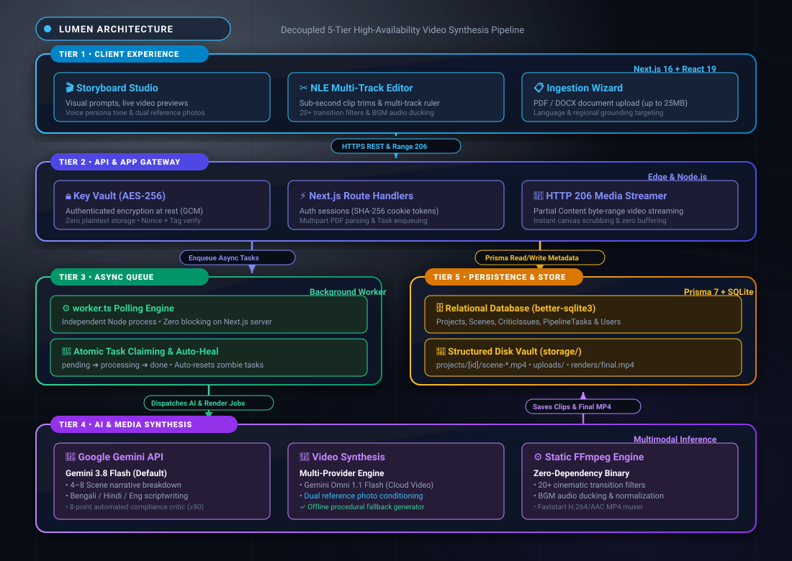
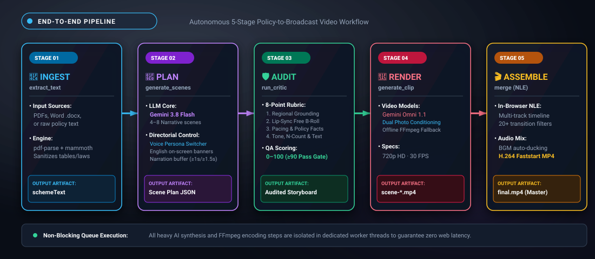
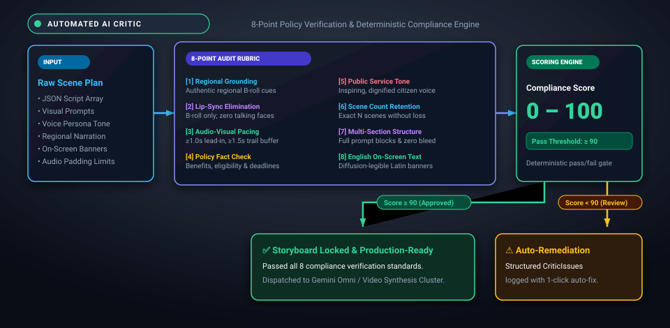
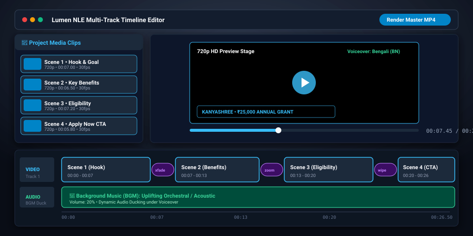
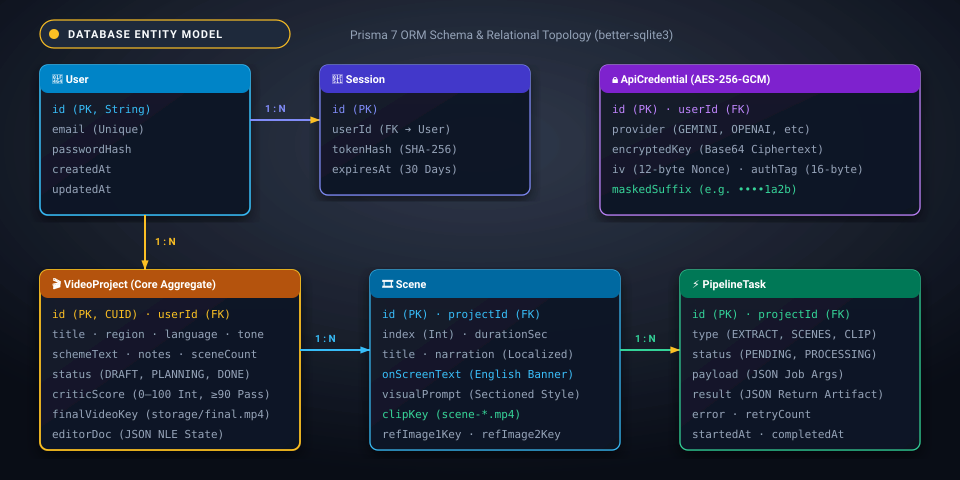
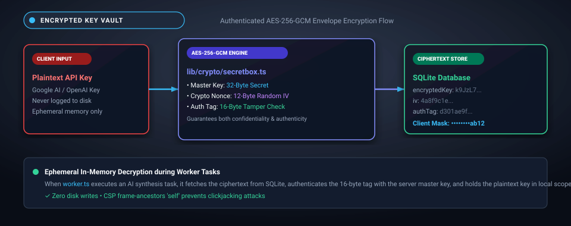

# 🎬 Lumen — AI Video Generation from Government Schemes

<p align="center">
  <strong>Transform raw government scheme policies, circulars, and PDF documents into broadcast-quality narrated video campaigns with AI.</strong>
</p>

<p align="center">
  
  
  
  
  
  
</p>

---

## 📑 Table of Contents

1. [Executive Overview](#executive-overview)
2. [Key Capabilities](#key-capabilities)
3. [System Architecture](#system-architecture)
4. [End-to-End Pipeline Workflow](#end-to-end-pipeline-workflow)
5. [AI Critic & Quality Assurance](#ai-critic-quality-assurance)
6. [Interactive NLE Video Editor](#interactive-nle-video-editor)
7. [Database Schema & Entity Model](#database-schema-entity-model)
8. [Security & Key Encryption Architecture](#security-key-encryption-architecture)
9. [Supported Models & Providers](#supported-models-providers)
10. [Repository Structure](#repository-structure)
11. [API Specification](#api-specification)
12. [Installation & Setup](#installation-setup)
13. [Environment Configuration](#environment-configuration)
14. [Running the Application](#running-the-application)
15. [Troubleshooting & FAQs](#troubleshooting-faqs)

---

<a id="executive-overview"></a>

## 🌟 Executive Overview

**Lumen** solves the citizen communication challenge in public policy. Government welfare schemes (e.g., *PM Vidyalaxmi*, *Kanyashree*, *PM-Surya Ghar*, *National Scholarship Portal*) are traditionally published in dense, multivariant government circulars and PDFs that citizens struggle to comprehend.

Lumen ingests these policy PDFs, parses the underlying rules, and autonomously plans, audits, renders, and stitches together localized video broadcasts. It couples **Google Gemini 3.8 Flash** for multimodal storyboarding and prompt engineering, an automated **AI Critic** for compliance verification, **Gemini Omni** (or cloud video models) for AI video synthesis, and an **in-browser Non-Linear Video Editor (NLE)** for fine-grained creative control.

---

<a id="key-capabilities"></a>

## ⚡ Key Capabilities

- **Multimodal Document Ingestion**: Upload native PDFs, Word documents (`.docx`), or plain text with instant inline previewing, dedicated tab inspection, automatic OCR, and structured text extraction in a unified single-card project wizard.
- **Multilingual AI Storyboard Engine**: Automatically segments complex schemes into 4–8 sequential scenes with localized narration (Bengali, Hindi, English), precise timing marks, and on-screen text banners.
- **Voice Persona & Tone Switcher**: Tailor outreach videos with distinct directorial narration personas: *Formal Government Broadcaster* (deep, authoritative), *Empathetic Mentor / Teacher* (warm, reassuring), and *Youth Beneficiary / Student* (energetic, relatable).
- **AI Critic Auditing**: Evaluates scene scripts before generation to guarantee zero unwanted lip-sync artifacts, strict regional visual grounding, and temporal audio-padding.
- **Dual-LLM Critic Architecture**: Run an independent model or provider (e.g. OpenAI GPT-4o or a distinct Gemini model) for the AI Critic agent to perform objective, unbiased compliance audits on storyboards.
- **Visual Prompt Editing & Reference Photos**: Fine-tune individual scene prompts right from the storyboard card, attach visual reference photos per scene or project-wide, and re-render only the affected clips.
- **Reference-Conditioned Video Synthesis**: Powered by **Google Gemini Omni 1.1 Flash** for state-of-the-art AI video generation with direct reference image conditioning, alongside a **100% offline FFmpeg procedural demo generator** that requires zero cloud credits.
- **Non-Linear Video Editor (NLE)**: Arrange clips on an interactive multi-track timeline with sub-second trimming, 20+ cinematic transition filters, BGM audio ducking, and one-click master MP4 compilation.
- **Hardware-Isolated Background Queue**: Dedicated worker architecture ensures that heavy AI generation, polling, and FFmpeg encoding never block web server responsiveness.
- **Enterprise-Grade Key Custody**: User-provided API keys are encrypted at rest with **AES-256-GCM** using unique per-secret nonces and authentication tags.

---

<a id="system-architecture"></a>

## 🏛 System Architecture

Lumen is built on a decoupled 5-tier architecture designed for high availability, zero server blocking, and secure multi-tenant execution:

<p align="center">
  
</p>

---

<a id="end-to-end-pipeline-workflow"></a>

## 🔄 End-to-End Pipeline Workflow

Lumen executes an autonomous **5-stage sequential transformation pipeline** that converts unstructured policy documents into complete broadcast video productions:

<p align="center">
  
</p>

---

### 📦 Pipeline Stage Breakdown

#### 📄 Stage 1: Document Ingestion & Text Extraction (`extract_text`)
* **Input**: Uploaded policy circular (PDF, DOCX, Markdown, or plain text) or pasted scheme details.
* **Processing**:
  * Evaluates file signatures and validates payload within 25MB upload limits.
  * Extracted via `pdf-parse` for binary PDFs and `mammoth` for Word documents.
  * Form-level client validation with 5-second auto-dismissing feedback prevents empty project creation when neither document nor text is provided.
  * Sanitizes whitespace, removes legalese boilerplate, and normalizes table structures.
* **Output**: Cleaned `schemeText` string saved directly to the project record.

---

#### 🧠 Stage 2: Multimodal Scene Planning (`generate_scenes`)
* **Input**: `schemeText` + target region (e.g. *West Bengal*) + narration language (e.g. *Bengali*) + voice persona & tone (*Formal Broadcaster*, *Empathetic Mentor*, or *Youth Beneficiary*) + scene count (exact 4, 5, 6, 7, or 8 scenes) + aspect ratio (`16:9`, `9:16`, `1:1`) + user storyboard notes.
* **Processing**:
  * Prompts **Gemini 3.8 Flash** with zero-shot system guidelines and an explicit structural breakdown for the exact requested scene count (4 to 8 scenes).
  * **Voice Persona & Directorial Tone**: Embeds distinct emotional and delivery guidelines into the script generation and visual directions based on the chosen persona (*🏛️ Formal Broadcaster*, *🎓 Empathetic Mentor*, or *⚡ Youth Beneficiary*).
  * **Strict Scene Count Enforcement**: Programmatic recovery and synthesis guarantees that the storyboard yields exactly the chosen scene count (e.g., choosing 8 scenes returns all 8 scenes without truncation to 5).
  * **Aspect Ratio & Framing**: Embeds targeted framing instructions (e.g. `9:16` vertical portrait mobile framing vs. `16:9` widescreen) into every scene's `visualPrompt` and `cameraAngle`.
  * **User Directives Reflection**: Weaves custom user instructions (specific people, settings, visual tone, do's & don'ts) directly into scene visual prompts and directorial guidelines.
  * Enforces programmatic timing guardrails: narration starts $\ge 1.0\text{s}$ and finishes $\ge 1.5\text{s}$ before the scene boundary for clean audio cross-fading.
* **Output**: Structured scene array persisted in the database with titles, durations, localized voiceovers, aspect-framed camera angles, and structured visual prompts.

---

#### 🛡️ Stage 3: AI Critic Auditing & Refinement (`run_critic`)
* **Input**: Generated scene plan + original scheme policy document + target aspect ratio + exact scene count + independent Critic LLM configuration (e.g., separate Gemini model or OpenAI GPT-4o).
* **Processing**:
  * Automated compliance audit checking 8 core quality criteria:
    1. **Regional Visual Grounding**: Ensures authentic architectural, cultural, and environmental cues.
    2. **Lip-Sync Elimination**: Enforces B-roll documentary visuals so synthesized voiceovers never clash with talking human faces.
    3. **Pacing & Buffer Timings**: Validates that narration comfortably fits within allocated seconds.
    4. **Fact Accuracy**: Cross-checks eligibility criteria, scholarship amounts, and deadline dates against the source document.
    5. **Tone & Dignity**: Verifies inspiring, clear, public-service framing.
    6. **Scene Count & Notes Retention**: Audits and preserves all $N$ scenes without merging or dropping items.
    7. **Rich Multi-Section Prompt Structure & Clean Directives**: Guarantees that refined visual prompts retain complete broadcast directions (`AUDIO`, `VISUAL SETTING`, `ON-SCREEN TEXT`, `CAMERA`, `USER NOTES APPLIED`, `NEGATIVE CONSTRAINTS`) without internal meta-prompt bleed (e.g. `FINAL PRIORITY:` instructions).
    8. **Legible On-Screen Text Standards**: Enforces that visual text highlights and numerals remain in clear English to avoid diffusion artifact distortion, while spoken narration stays localized in regional languages.
* **Output**: Computes a 0–100 compliance score, logs specific remediation issues, and outputs a refined storyboard ready for production with rich visual prompts.

---

#### 🎥 Stage 4: Scene Video Clip Synthesis (`generate_clip`)
* **Input**: Individual scene visual prompt + aspect ratio (16:9 widescreen or 9:16 vertical) + target duration.
* **Processing**:
  * Dispatches generation task to the video provider:
    * **Google Gemini Omni 1.1 Flash**: State-of-the-art multimodal AI video model for broadcast-quality photorealistic scenes.
    * **Offline Procedural Engine**: Generates smooth 720p procedural gradient footage with FFmpeg for testing without spending credits.
  * Normalizes FPS to 30fps and extracts a high-resolution poster thumbnail (`thumb.jpg`).
* **Output**: 720p `.mp4` video clip saved to `storage/projects/<projectId>/scene-<index>.mp4`.

---

#### 🎬 Stage 5: NLE Timeline Assembly & Final Master Merge (`merge`)
* **Input**: Edited timeline sequence document (`editor.json`) + selected background music (BGM) + transition settings.
* **Processing**:
  * Non-destructive assembly: allows users to reorder scenes, trim sub-clips, add transitions (fade, dissolve, wipe, zoom), and set BGM volume.
  * FFmpeg constructs complex filtergraphs (`xfade` for video transitions, `amix` with audio ducking for narration and background tracks).
  * Encodes to H.264/AAC with faststart flags for instant web playback.
* **Output**: Broadcast-ready master video saved to `storage/projects/<projectId>/final.mp4`.

---

<a id="ai-critic-quality-assurance"></a>

## 🛡 AI Critic & Quality Assurance

Public outreach videos require strict governance before publication. The **Lumen Critic** evaluates every generated scene against **8 deterministic quality criteria** and enforces a strict **$\ge 90$ compliance pass threshold**:

<p align="center">
  
</p>

### The 8-Point Audit Rubric

| # | Criterion | Focus Area | Requirement for Approval |
|---|---|---|---|
| **1** | **Regional Visual Grounding** | Cultural & Geographic Authenticity | Scenic visual directions must feature authentic regional architecture, clothing, and landscape cues (e.g. terracotta temples, tram lines for West Bengal). |
| **2** | **Lip-Sync Elimination** | Audio-Visual Decoupling | Strictly enforces documentary B-roll visuals so synthesized voiceovers never fight with human lip-sync artifacts. |
| **3** | **Audio-Visual Pacing** | Timing Padding | Validates that narration fits within scene duration with $\ge 1.0\text{s}$ lead-in and $\ge 1.5\text{s}$ trail buffer for smooth audio ducking and transitions. |
| **4** | **Policy Fact Check** | Truth & Authenticity | Cross-checks scholarship figures, income ceilings, eligibility criteria, and portal URLs against the ingested source policy. |
| **5** | **Public Service Tone** | Citizen Engagement | Verifies inspiring, dignified, citizen-first framing aligned with the chosen **Voice Persona** (Broadcaster, Mentor, or Youth). |
| **6** | **Scene Count Retention** | Structural Integrity | Guarantees that the storyboard retains all requested $N$ scenes (4 to 8) without unprompted truncation or merging. |
| **7** | **Multi-Section Prompt Structure** | Diffusion Directives | Ensures prompts contain complete structured blocks (`AUDIO`, `VISUAL SETTING`, `ON-SCREEN TEXT`, `CAMERA`, `USER NOTES`) with zero internal meta-prompt leak. |
| **8** | **English On-Screen Text & Numerals** | Diffusion Legibility | Mandates that lower-third text overlays and monetary figures are rendered in clear Latin/English characters to prevent diffusion distortion, while spoken audio stays in the regional tongue. |

### Deterministic Pass/Fail Gating
* **Score $\ge 90$**: The storyboard is automatically locked and marked **Production Ready**, enabling batch dispatch to the video synthesis engine.
* **Score $< 90$**: The audit produces actionable `CriticIssues` with precise remediation suggestions, allowing users to trigger a 1-click automated storyboard regeneration.

---

<a id="interactive-nle-video-editor"></a>

## ✂️ Interactive NLE Video Editor

Lumen contains a fully featured in-browser **Non-Linear Video Editor**:

<p align="center">
  
</p>

### Transition Library
Choose from **20+ hardware-accelerated transitions**:
- **Dissolves**: `fade`, `dissolve`, `fadeblack`, `fadewhite`
- **Directional Slides**: `slideleft`, `slideright`, `slideup`, `slidedown`, `smoothup`, `smoothdown`
- **Wipes & Crops**: `wipeleft`, `wiperight`, `circlecrop`, `circleopen`
- **Stylized Effects**: `pixelize`, `radial`, `zoomin`, `hblur`, `squeezeh`

---

<a id="database-schema-entity-model"></a>

## 🗄 Database Schema & Entity Model

Lumen utilizes Prisma ORM with SQLite for zero-config local portability:

<p align="center">
  
</p>

---

<a id="security-key-encryption-architecture"></a>

## 🔒 Security & Key Encryption Architecture

All sensitive API keys provided by users (Google AI Studio, OpenAI, Replicate, Fal) are encrypted with envelope security:

<p align="center">
  
</p>

- **Zero Plaintext Logging**: Keys are decrypted ephemerally in memory only during worker API dispatches.
- **Client-Side Masking**: The browser only ever receives a 4-character masked suffix (e.g., `•••••••••ab12`).
- **Clickjacking & Framing Mitigation**: Full Content-Security-Policy (CSP) with `frame-ancestors 'self'` and `X-Frame-Options: SAMEORIGIN` allows same-origin preview modals while blocking third-party embed attacks.

---

<a id="supported-models-providers"></a>

## 🤖 Supported Models & Providers

### Large Language Models (LLM)

| Provider | Model Identifier | Tier | Best Suited For |
|---|---|---|---|
| **Google Gemini** | `gemini-3.5-flash` *(Default)* | Multimodal | High-speed, high-stability scheme breakdown |
| **Google Gemini** | `gemini-3.8-flash` | Multimodal | Experimental high-context storyboarding |
| **Google Gemini** | `gemini-3.1-flash-lite` | Efficient | Ultra-low latency draft generation |
| **OpenAI** | `gpt-4o` | Multimodal | Deep semantic policy analysis |
| **OpenAI** | `gpt-4o-mini` | Fast | Budget-friendly storyboard drafting |
| **OpenAI** | `o4-mini` | Reasoning | Rigorous structural scheme analysis |

### Video Generation Models

| Provider | Model Name | Format | Description |
|---|---|---|---|
| **Google Gemini** | `gemini-omni-1.1-flash` *(Default)* | Cloud Video | Native multimodal video generation with direct reference image conditioning |
| **Offline Demo** | `FFmpeg Procedural` | Local | Generates dynamic 720p clips without API keys |

---

<a id="repository-structure"></a>

## 📁 Repository Structure

```
├── app/                              # Next.js 16 App Router
│   ├── (app)/                        # Authenticated Shell Layout
│   │   ├── studio/                   # Studio Workspace & Projects
│   │   │   ├── [id]/                 # Project Storyboard View
│   │   │   │   └── editor/           # NLE Video Editor
│   │   │   └── new/                  # Project Creation Wizard
│   │   ├── demo/                     # Zero-credit Offline Editor Demo
│   │   └── settings/                 # API Key Management
│   ├── api/                          # REST & Streaming Endpoints
│   │   ├── assets/[id]/              # HTTP Range media streamer
│   │   ├── credentials/              # Encrypted key storage
│   │   ├── models/                   # Dynamic provider catalog
│   │   ├── projects/[id]/clips/      # Clip generation triggers
│   │   └── uploads/                  # Multipart document upload handler
│   ├── globals.css                   # Custom Design System
│   └── layout.tsx                    # Root Layout
├── components/                       # Modular UI Components
│   ├── editor/                       # Video Editor (Timeline, Canvas, Stage)
│   ├── studio/                       # SceneCard, Wizard, AssetPreview
│   └── site/                         # Navigation, Headers, Logos
├── lib/                              # Core Business Logic & Infrastructure
│   ├── crypto/                       # AES-256-GCM SecretBox implementation
│   ├── documents/                    # PDF & Word Document Parsers
│   ├── llm/                          # Gemini & OpenAI client wrappers
│   ├── pipeline/                     # Task queue, runner, critic, prompts
│   ├── providers/                    # Video generators & FFmpeg wrappers
│   ├── db.ts                         # Prisma Client Singleton
│   └── storage.ts                    # Abstracted Storage Driver
├── prisma/                           # Database Schema & Migrations
│   └── schema.prisma                 # SQLite Models
├── scripts/                          # Background Runners
│   └── worker.ts                     # Asynchronous Task Queue Worker
└── storage/                          # Local Storage Target (ignored by Git)
    ├── projects/                     # Scene clips & master videos
    ├── renders/                      # Temporary clip exports
    └── uploads/                      # Uploaded PDFs and images
```

---

<a id="api-specification"></a>

## 🔌 API Specification

| Endpoint | Method | Purpose |
|---|---|---|
| `/api/auth/login` | `POST` | Authenticates user and issues 30-day session cookie |
| `/api/auth/signup` | `POST` | Registers a new user account |
| `/api/credentials` | `GET` / `POST` | Retrieves masked keys or encrypts and saves an API key |
| `/api/models` | `GET` | Fetches active provider catalog and key readiness status |
| `/api/uploads` | `POST` | Ingests document/photo files up to 25MB |
| `/api/projects` | `GET` / `POST` | Lists all projects or creates a new video project |
| `/api/projects/:id` | `GET` / `PATCH` | Retrieves project details or edits project settings |
| `/api/projects/:id/scenes/:sceneId` | `PATCH` | Updates scene title or visual prompt |
| `/api/projects/:id/scenes/:sceneId/references` | `POST` / `DELETE` | Binds or removes reference conditioning photos for a scene |
| `/api/projects/:id/clips` | `POST` | Triggers render task for one or all scenes |
| `/api/projects/:id/merge` | `POST` | Compiles timeline sequence into a single MP4 |
| `/api/assets/:id` | `GET` | Streams files supporting `Range: bytes` seek headers |

---

<a id="installation-setup"></a>

## 🚀 Installation & Setup

### Prerequisites
- **Node.js**: `v18.18.0` or higher (Node 20+ recommended)
- **pnpm**: `v9.0.0` or higher (`npm install -g pnpm`)
- **Operating System**: macOS, Linux, or Windows WSL2

### 1. Clone & Install
```bash
git clone https://github.com/your-username/lumen.git
cd lumen
pnpm install
```

### 2. Configure Environment
Generate your master encryption key:
```bash
openssl rand -base64 32
```
Create your `.env` file:
```bash
cp .env.example .env
```
Fill in the generated encryption key and standard values (see below).

### 3. Initialize the Database
```bash
pnpm db:push
```

---

<a id="environment-configuration"></a>

## ⚙️ Environment Configuration

| Variable | Required | Default | Description |
|---|---|---|---|
| `DATABASE_URL` | **Yes** | `file:./dev.db` | SQLite database file location |
| `SESSION_SECRET` | **Yes** | — | Cryptographic secret for signing session cookies |
| `CREDENTIAL_ENCRYPTION_KEY` | **Yes** | — | 32-byte base64 key for AES-256-GCM encryption |
| `STORAGE_DRIVER` | No | `local` | Storage driver (`local` or extensible to `s3`) |
| `STORAGE_LOCAL_DIR` | No | `./storage` | Filesystem path for media assets |
| `WORKER_POLL_MS` | No | `1500` | Task queue polling frequency in milliseconds |
| `GEMINI_API_KEY` | Optional | — | Fallback server-level Google AI Studio key |
| `OPENAI_API_KEY` | Optional | — | Fallback server-level OpenAI key |

---

<a id="running-the-application"></a>

## 🏃 Running the Application

### 1. Start the Development Web Server
```bash
pnpm dev
```
Visit **[http://localhost:3000](http://localhost:3000)** in your browser.

### 2. Start the Background Pipeline Worker
In a separate terminal tab, run the queue worker:
```bash
pnpm worker
```

> 💡 **Tip**: To run a quick test of the offline editor without setting up any cloud API keys, click **"Editor demo"** in the top navigation bar!

---

<a id="troubleshooting-faqs"></a>

## ❓ Troubleshooting & FAQs

#### Q: The video clip fails with "Gemini Omni interaction failed"?
`gemini-omni-1.1-flash` video generation requires a Google AI Studio account with billing enabled or a Google Cloud Vertex AI project. If you are on the free tier, you can use the **Offline Editor Demo** or configure **Replicate/Fal** in Settings.

#### Q: The preview modal says "localhost refused to connect"?
This is caused by CSP headers blocking same-origin iframes. Ensure your `next.config.mjs` sets `frame-ancestors 'self'` and `X-Frame-Options: SAMEORIGIN` (already configured by default).

#### Q: The uploaded PDF preview displays "Not found"?
Uploaded documents are addressed by logical storage keys under `storage/uploads/<userId>/<assetId>/`. Ensure the storage directory exists and has read permissions. The preview modal also provides an **"Open in tab ↗"** button to view or download the file directly in a dedicated browser tab.

#### Q: How do I inspect the SQLite database visually?
Run the following command to launch Prisma Studio:
```bash
pnpm db:studio
```

---

<p align="center">
  <sub>Built with ❤️ by the COE Education Team.</sub>
</p>
